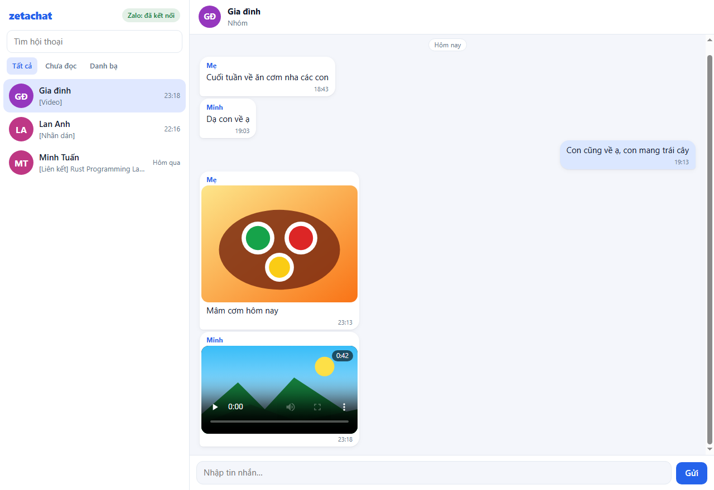

# zetachat

Gateway tự host để dùng **Zalo trên nhiều thiết bị của chính mình**: một phiên đăng nhập duy nhất chạy trên máy chủ ở nhà, các thiết bị khác kết nối vào qua LAN hoặc VPN. Lõi giao thức viết bằng Rust.

> [!WARNING]
> Đây là dự án **không chính thức**, không liên quan tới VNG hay Zalo. Giao thức được tái hiện để tương thích. Dùng client không chính thức có thể vi phạm điều khoản sử dụng của Zalo và khiến tài khoản bị khóa, vì vậy hãy thử bằng tài khoản phụ.

## Vì sao

- Mỗi tài khoản Zalo chỉ có **một suất đăng nhập máy tính** bên cạnh điện thoại; đăng nhập máy thứ hai sẽ đẩy máy trước ra. Giữ một phiên trên máy chủ rồi cho nhiều client nối vào giải quyết việc này.
- Zalo PC (Electron) dùng khoảng **1 GB RAM** trên Windows. Phần nặng (giao thức, mã hóa, lưu trữ) chuyển lên máy chủ, client chỉ còn việc hiển thị.
- Máy chủ luôn bật nên không sót tin; hẹn giờ gửi và tự trả lời vẫn chạy khi máy tính đã tắt.

## Kiến trúc

```text
               Máy chủ Zalo
                     ▲  1 phiên (HTTP + WebSocket)
┌─ Máy chủ ở nhà ────┴─────────────────────┐
│ zetachat gateway (Rust, chạy nền 24/7)   │
│  • zeta-zalo: lõi giao thức Zalo         │
│  • (sau) connector Telegram              │
│  • SQLite: tin nhắn, media, đã đọc       │
│  • API cho client: REST + WebSocket      │
└────────────────────┬─────────────────────┘
                     │  LAN / VPN (không mở ra Internet)
       ┌─────────────┼──────────────┐
  PC Windows      Laptop   Tablet / điện thoại
```

Chi tiết trong [docs/KIEN_TRUC.md](docs/KIEN_TRUC.md). Những gì đã kiểm chứng về giao thức nằm ở [docs/GIAO_THUC.md](docs/GIAO_THUC.md).

## Trạng thái

| Giai đoạn | Nội dung | Trạng thái |
|---|---|---|
| 0 | Chạy thử một phiên Zalo trên máy chủ (bằng ctdozlite) | Phiên chạy được, tin đến và đi về tới máy chủ trong vài giây; đang đo độ bền qua nhiều ngày |
| 1 | `zeta-zalo`: lõi giao thức tách từ ctdozlite | Đã có và đã chạy với Zalo thật: đăng nhập QR, lưu phiên, kiểm tra phiên, bạn bè, nhóm, tin gần đây, gửi tin, WebSocket thời gian thực |
| 2 | Gateway: dịch vụ nền, SQLite, API, token theo thiết bị | Đã chạy với Zalo thật: nhận tin qua WebSocket, gửi tin (không trùng khi Zalo gửi lại bản sao), đồng bộ danh bạ và nhóm, proxy và bộ nhớ đệm media (ảnh, video, sticker, tệp). Bản release khoảng 10 MB, dùng vài MB RAM khi rảnh |
| 3 | Client: giao diện web (PWA), bản Windows bằng Tauri | Đã có giao diện web do gateway phục vụ: hội thoại, gửi/nhận thời gian thực, ảnh (bấm để phóng to), video, sticker, tin nhắn thoại, tệp, thẻ liên kết; ảnh đại diện (của mình, bạn bè, nhóm, người gửi tin trong nhóm); tab Bạn bè và Nhóm (số thành viên); ô tìm kiếm chung cho bạn bè, nhóm và nội dung tin nhắn (không cần gõ dấu, bấm vào kết quả để tới đúng tin); thả và xem cảm xúc; trả lời tin, sao chép, thu hồi tin của mình; hiện "đang soạn tin…"; gửi ảnh và tệp tới 1 GB như Zalo PC (nút gửi ảnh, nút đính kèm, dán ảnh, kéo thả; có thanh tiến độ và nút hủy); thông báo, đăng nhập Zalo bằng QR, cài được như app. Chưa có bản Tauri |
| 4 | Connector Telegram (TDLib) | Dự kiến |

## Cấu trúc

| Đường dẫn | Nội dung |
|---|---|
| `crates/zeta-zalo` | Lõi giao thức: mã hóa, đăng nhập QR, phiên, API, WebSocket |
| `crates/zeta-zalo/examples/zeta.rs` | CLI cho nhà phát triển, để thử với tài khoản thật |
| `crates/zeta-gateway` | Gateway (`zetachat-gateway`): SQLite, API REST và SSE, token thiết bị, connector Zalo, bộ nhớ đệm media |
| `crates/zeta-gateway/web` | Giao diện web (JavaScript thuần, không cần build), được nhúng vào binary |
| `deploy/` | File dịch vụ systemd |
| `docs/` | [Kiến trúc](docs/KIEN_TRUC.md), [giao thức](docs/GIAO_THUC.md), [API](docs/API.md), [triển khai](docs/TRIEN_KHAI.md) |

## Build và test

Cần Rust stable ([rustup.rs](https://rustup.rs/)); không cần thư viện hệ thống nào khác.

```bash
cargo test --workspace
cargo clippy --workspace --all-targets -- -D warnings
```

Thử giao diện với dữ liệu mẫu, không cần tài khoản Zalo:

```bash
cargo run -p zeta-gateway -- --data-dir demo-data device add "Thử"   # in ra token và link ghép
cargo run -p zeta-gateway -- --data-dir demo-data serve --demo
# mở http://127.0.0.1:8370/#token=<token> trong trình duyệt
```



Chạy với Zalo thật (dữ liệu nằm trong `./data`):

```bash
cargo run -p zeta-gateway -- device add "Laptop"   # tạo token cho một thiết bị
cargo run -p zeta-gateway -- serve                 # lắng nghe 127.0.0.1:8370, đăng nhập Zalo ngay trên giao diện
```

Triển khai lên máy chủ: xem [docs/TRIEN_KHAI.md](docs/TRIEN_KHAI.md).

CLI thử nghiệm lõi giao thức:

```bash
cargo run --example zeta -- login   data/session.json      # quét mã QR bằng app Zalo
cargo run --example zeta -- check   data/session.json      # VALID / EXPIRED / UNREACHABLE
cargo run --example zeta -- friends data/session.json
cargo run --example zeta -- send    data/session.json user <uid> "xin chào"
cargo run --example zeta -- listen  data/session.json 60   # sự kiện thời gian thực
```

## Bảo mật

- File phiên (`session.json`) chứa cookie `zpw_sek` và khóa `zpw_enk`: ai có file này là dùng được tài khoản. `SessionData::save` ghi file với quyền chỉ chủ sở hữu đọc được (trên Unix). Đừng chia sẻ hay commit file này; `.gitignore` đã chặn sẵn.
- Log và thông báo lỗi không chứa URL kèm tham số, cookie hay khóa.
- Gateway sẽ không bao giờ mở ra Internet: truy cập từ xa qua VPN, mỗi thiết bị một token riêng.
- Thiết bị không gọi thẳng tới Zalo: ảnh và video đi qua gateway, và gateway chỉ tải từ tên miền media của Zalo. Tệp không phải ảnh, video hay âm thanh luôn được tải về như tệp đính kèm, không bao giờ mở như một trang web.

## Ghi công và giấy phép

Phát hành theo **MIT OR Apache-2.0** ([LICENSE-MIT](LICENSE-MIT), [LICENSE-APACHE](LICENSE-APACHE)).

Phần lớn lõi giao thức được port từ [ctdozlite](https://github.com/ctdoteam1110/ctdozlite) (MIT OR Apache-2.0), xem [NOTICE](NOTICE). Cảm ơn các tác giả ctdozlite đã công bố phần reverse-engineering. zetachat không đóng gói mã JavaScript, hình ảnh hay sticker của Zalo.

---

## English summary

zetachat is a self-hosted gateway that keeps a single Zalo session on a home server and lets your own devices connect to it over LAN or VPN. It works around Zalo's one-desktop-session limit and the ~1 GB of RAM used by the official Electron client. `crates/zeta-zalo` is the Rust protocol core (QR login, session persistence, request encryption, a first set of APIs, the real-time WebSocket), largely ported from ctdozlite with fixes for two bugs described in `docs/GIAO_THUC.md`. Unofficial and not affiliated with VNG or Zalo; using it may violate Zalo's terms of service.
